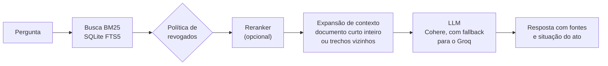
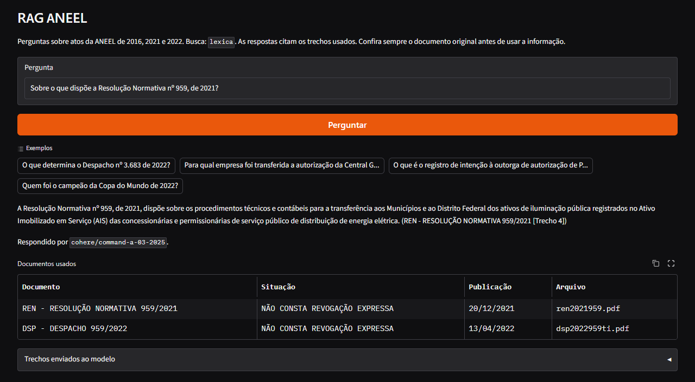

# RAG ANEEL — Perguntas e respostas sobre atos regulatórios

Sistema de **Retrieval-Augmented Generation (RAG)** que responde perguntas sobre o corpus regulatório da ANEEL (Agência Nacional de Energia Elétrica): **18.688 atos de 2016, 2021 e 2022**, com **26.747 arquivos indexados** (textos integrais, votos, notas técnicas e anexos) e **517.557 chunks**. Cada resposta cita os documentos usados e avisa quando o ato foi revogado.

O foco do projeto é ser **medido**: toda mudança foi testada contra um conjunto de perguntas com gabarito antes de ser adotada, e as que não melhoraram foram descartadas e registradas.

## Resultados em resumo

Conjunto de ouro v1: 56 perguntas escritas a partir de atos sorteados, 46 com resposta no corpus e 10 que devem ser recusadas. LLM `openai/gpt-oss-120b` no Groq.

| Métrica | Primeira versão (busca vetorial) | Versão atual |
|---|---|---|
| Documento certo entre os 5 trechos recuperados (hit@5) | 0,130 | **0,935** |
| Resposta com os termos esperados | 6 de 46 | **41 de 46** |
| Recusa indevida (havia resposta e o sistema recusou) | 39 de 46 | **6 de 46** |
| Recusa correta (a pergunta não tem resposta no corpus) | 10 de 10 | 10 de 10 |

No conjunto v2, com 127 perguntas (inclui Resoluções Normativas, atos revogados e perguntas conceituais sem número de ato), o hit@5 é de 0,835, e de 0,870 com o reranker opcional. De ponta a ponta, 94 de 115 respostas trazem os termos esperados, e as 12 perguntas sem resposta foram recusadas. As perguntas conceituais são o ponto fraco: hit@5 de 0,500. Metodologia e todas as rodadas em [docs/avaliacao/RESULTADOS.md](docs/avaliacao/RESULTADOS.md); as decisões e o que foi descartado, em [docs/DECISOES.md](docs/DECISOES.md).

## Como funciona



- **Busca léxica (BM25):** as perguntas sobre atos citam números, nomes de empresas e de usinas, e a busca por palavras acerta muito mais do que a busca por embeddings (hit@5 de 0,870 contra 0,130). A busca vetorial e a híbrida continuam configuráveis.
- **Política de revogados:** busca só nos atos vigentes, mas inclui os revogados quando a pergunta cita um ato, pergunta sobre vigência ou quando nada vigente é encontrado.
- **Expansão de contexto:** a busca costuma achar o documento certo, mas não o trecho com a resposta. Documentos curtos vão inteiros ao LLM; dos longos vão os trechos encontrados e seus vizinhos.
- **Recusa:** sem evidência nos trechos, o modelo responde que não encontrou a informação, em vez de inventar.

**Stack:** Python, SQLite FTS5, ChromaDB e `sentence-transformers` (modos vetorial e híbrido), Cohere e Groq, Gradio na demo, pytest e ruff no CI do GitHub Actions. O índice fica no Hugging Face e é baixado na primeira execução.



*Demo em Gradio (`python scripts/app.py`): a resposta cita o trecho usado, e a tabela mostra os documentos e a situação de cada ato.*

---

## Quick Start — Usar o sistema (recomendado)

> O vectorstore com o corpus de 2016, 2021 e 2022 já está pré-construído e hospedado no Hugging Face.
> Ele é baixado automaticamente na primeira execução. Você **não precisa** baixar PDFs nem gerar embeddings.
> A busca padrão usa só o acervo léxico (`lexico.sqlite3`, cerca de 0,6 GB), sem o índice vetorial nem o modelo de embeddings.

### Pré-requisitos

| Requisito           | Detalhe                                                                        |
| ------------------- | ------------------------------------------------------------------------------ |
| Git                 | [Download](https://git-scm.com/downloads) (ou baixe o repositório como .ZIP)   |
| Python 3.11+        | Testado em 3.14.3. [Download](https://www.python.org/downloads/)               |
| Chave de API Cohere | Crie em [dashboard.cohere.com](https://dashboard.cohere.com/api-keys) — LLM principal |
| Chave de API Groq   | Crie em [console.groq.com](https://console.groq.com) — usado como fallback     |
| Espaço em disco     | ~0,6 GB com o acervo léxico pronto; ~5 GB se ele for criado localmente         |
| RAM                 | Pico medido de 113 MB na busca léxica e de 3,2 GB na vetorial                  |

### Passo 1 — Obtenha o código do repositório

**Opção A: Usando o Git (Recomendado)**
```bash
git clone https://github.com/GuilhermeBarros12/rag_aneel.git
cd rag_aneel
```

**Opção B: Sem usar o Git (Download via ZIP)**
Caso não tenha o Git instalado, acesse a página do repositório no GitHub, clique no botão verde **"<> Code"** e selecione **"Download ZIP"**. Extraia a pasta e abra o terminal dentro dela.

### Passo 2 — Execute o setup

O script cria o ambiente virtual, instala todas as dependências e prepara o `.env`.
Nota: Se o script de setup falhar, você pode criar o ambiente manualmente: python -m venv .venv e depois pip install -r requirements.txt.

**Windows:**

```bat
.\setup.bat
```

**Linux/Mac:**

```bash
chmod +x setup.sh && ./setup.sh
```

### Passo 3 — Configure suas chaves de API

Abra o arquivo `.env` criado pelo setup e preencha(OBS: Caso tenha feito o processo manual, copie o arquivo .env.example para um novo arquivo chamado .env e preencha com suas chaves: )

```env
COHERE_API_KEY=sua_chave_aqui    # https://dashboard.cohere.com/api-keys
GROQ_API_KEY=sua_chave_aqui      # https://console.groq.com (fallback)
HF_REPO_ID=guilhermebarros/rag-aneel-vectorstore  # já preenchido
HF_TOKEN=                        # deixe vazio: só é necessário para enviar o índice
```

### Passo 4 — Ative o ambiente virtual

**Windows:**

```bat
.venv\Scripts\activate
```

**Linux/Mac:**

```bash
source .venv/bin/activate
```

### Passo 5 — Inicie o pipeline

```bash
python scripts/pipeline.py
```

Na **primeira execução**, o sistema baixa do Hugging Face só o acervo léxico (cerca de 0,6 GB). Os modos `densa` e `hibrida` também precisam do índice vetorial (~4,4 GB) e do modelo de embeddings (1,1 GB), baixados automaticamente.
Nas execuções seguintes, ele já estará em disco e o sistema inicia em segundos.

**Modo direto (uma pergunta):**

```bash
python scripts/pipeline.py --query "O que é o registro de intenção à outorga de autorização de PCH?"
```

**Demo web:**

```bash
python scripts/app.py
# Abra http://127.0.0.1:7860 no navegador.
```

A demo mostra a resposta, o LLM que respondeu, os documentos usados com a situação de cada ato e os trechos enviados ao modelo.

**Modo interativo (loop de perguntas):**

```bash
python scripts/pipeline.py
# Digite suas perguntas e pressione Enter. Digite 'sair' para encerrar.
```

---

## Arquitetura do Pipeline

```
Documentos ANEEL (PDFs, HTMLs, XLSXs)
          │
          ▼
   [1] downloads.py          → baixa os arquivos da ANEEL (2016, 2021, 2022)
          │
          ▼
   [2] ingestao.py           → converte PDF/HTML → Markdown (.md)
          │                     preservando tabelas e metadados
          ▼
   [3] chunking.py           → divide os .md em chunks de 512 chars
          │                     com sobreposição de 80 chars → 517.557 chunks
          ▼
   [4] indexar.py            → gera embeddings multilinguais e
          │                     persiste no ChromaDB (HNSW cosine)
          ▼
   [4b] lexico.py            → cria o índice BM25 (SQLite FTS5)
          │                     a partir dos chunks do ChromaDB
          ▼
   [5] pipeline.py           → recebe query → recupera chunks →
          │                     gera resposta com LLM (Cohere → Groq)
          ▼
   [6] avaliar.py            → roda 100 perguntas com o mesmo código
                                do pipeline e salva as respostas
```

---

## Reconstruir o pipeline do zero (avançado / opcional)

> Esta seção é necessária **apenas** para quem quiser reprocessar todos os documentos
> da ANEEL desde o início — por exemplo, para atualizar o corpus ou reproduzir o experimento completo.
> Para uso normal, siga o Quick Start acima.

### Pré-requisitos adicionais

| Requisito       | Detalhe                                     |
| --------------- | ------------------------------------------- |
| Google Chrome   | Para download automatizado via Selenium     |
| RAM             | 8 GB recomendado (estimativa, não medido)   |
| Espaço em disco | ~10 GB (PDFs, índice e modelo), mais chunks |
| Tempo estimado  | ~6-10 horas (estimativa, não medido)        |

### Passo 1 — Download dos documentos (~26.900 arquivos)

O `downloads.py` usa o Selenium para navegar no portal da ANEEL e baixar todos os PDFs.
O `download_extras.py` baixa os arquivos complementares (HTML, XLSX, XLSM).

**Tempo estimado:** várias horas (depende da conexão). Ambos os scripts têm **retomada automática** — se interrompidos, continuam de onde pararam.

```bash
python scripts/downloads.py        # baixa os PDFs principais → dados/pdfs/
python scripts/download_extras.py  # baixa HTMLs e planilhas  → dados/extras/
```

> Requer o Google Chrome instalado. O ChromeDriver é gerenciado automaticamente pelo `webdriver-manager`.

### Passo 2 — Conversão PDF/HTML → Markdown

Converte cada arquivo baixado para Markdown, preservando tabelas e adicionando metadados
(título, autor, situação, assunto) no cabeçalho de cada arquivo.

**Tempo estimado:** 1-2 horas. Tem retomada automática.

```bash
python scripts/ingestao.py   # gera .md em chunks_md/
```

### Passo 3 — Chunking dos documentos

Divide cada Markdown em chunks de 512 caracteres com sobreposição de 80 caracteres e
descarta trechos com menos de 50 caracteres (ruído). Tabelas não são cortadas, então
28.845 chunks passam de 512 caracteres.

**Resultado:** 508.156 chunks indexados, a partir de arquivos `.txt` em `chunks/`

```bash
python scripts/chunking.py   # gera .txt em chunks/
```

### Passo 4 — Geração de embeddings e indexação

Gera embeddings com o modelo `paraphrase-multilingual-mpnet-base-v2` (768 dimensões)
e persiste tudo no ChromaDB com índice HNSW e similaridade de cosseno.

**Tempo estimado:** 4-8 horas (508K chunks). Tem retomada automática — chunks já indexados são pulados.

```bash
python scripts/indexar.py    # popula vectorstore/
```

> Para máquinas com menos de 8 GB de RAM, use `--batch-size 32`.

### Passo 5 — Upload do vectorstore para o Hugging Face

Após a indexação, envie o vectorstore para o Hugging Face Hub para que outros
possam usar o sistema sem precisar repetir o processo.

```bash
python scripts/upload_vectorstore.py
```

> Requer `HF_TOKEN` (tipo Write) e `HF_REPO_ID` configurados no `.env`.
> Para enviar só o acervo léxico, use `python scripts/upload_vectorstore.py --acervo`.

---

## Rodar com Docker (avançado)

> **Não testado.** O `Dockerfile` e o `docker-compose.yml` foram revisados, mas ainda não foram executados de ponta a ponta. Prefira o Quick Start.
>
> O Docker cobre os passos 2 a 6 do pipeline (ingestão, chunking, indexação, pipeline e avaliação).
> O download dos dados (passo 1) deve ser feito localmente antes, pois requer o Google Chrome.

```bash
# Build da imagem
docker-compose build

# Rodar cada etapa
docker-compose run rag python scripts/ingestao.py
docker-compose run rag python scripts/chunking.py
docker-compose run rag python scripts/indexar.py
docker-compose run rag python scripts/pipeline.py
docker-compose run rag python scripts/avaliar.py

# Shell interativo
docker-compose run rag bash
```

Os dados são montados como volumes — nenhum arquivo de dados é copiado para dentro da imagem.

---

## Estrutura de Pastas

```
projeto_rag/
│
├── scripts/                    # Todo o código do pipeline
│   ├── config.py               # Configuração única (caminhos, modelos, top_k, prompt)
│   ├── nucleo.py               # Recuperação, prompt e geração, usados por pipeline e avaliar
│   ├── downloads.py            # [Passo 1] Download dos PDFs da ANEEL
│   ├── download_extras.py      # [Passo 1b] Download de HTML/XLSX
│   ├── ingestao.py             # [Passo 2] PDF/HTML → Markdown
│   ├── chunking.py             # [Passo 3] Markdown → chunks .txt
│   ├── indexar.py              # [Passo 4] Chunks → embeddings → ChromaDB
│   ├── lexico.py               # Acervo léxico: textos, metadata e busca BM25 (SQLite FTS5)
│   ├── validacao.py            # Reconhece páginas de bloqueio baixadas no lugar do documento
│   ├── limpar_indice.py        # Gera uma cópia do índice sem páginas de bloqueio
│   ├── atualizar_documentos.py # Reindexa só alguns documentos, sem refazer o corpus
│   ├── app.py                  # Demo web (Gradio)
│   ├── pipeline.py             # [Passo 5] Linha de comando do RAG (query → resposta)
│   ├── upload_vectorstore.py   # Sobe o vectorstore para o Hugging Face
│   ├── avaliar.py              # [Passo 6] Benchmark de 100 perguntas
│   └── avaliar_ouro.py         # Métricas no conjunto de ouro (hit@k, MRR, abstenção)
│
├── dados/                      # Dados brutos (não versionados)
│   ├── pdfs/                   # PDFs originais da ANEEL
│   ├── jsons/                  # Metadados dos documentos
│   └── extras/                 # HTMLs e planilhas (.xlsx, .xlsm)
│
├── chunks_md/                  # Markdowns gerados (não versionados)
├── chunks/                     # Chunks .txt gerados (não versionados)
├── vectorstore/                # Índice ChromaDB (não versionado)
├── vectorstore_lexico/         # Acervo léxico, cerca de 0,6 GB (não versionado)
├── tests/                      # Testes automáticos (pytest), sem rede nem chaves
├── docs/avaliacao/             # Conjunto de ouro e resultados medidos
│
├── Dockerfile                  # Imagem Docker do pipeline
├── docker-compose.yml          # Orquestração dos containers
├── setup.bat                   # Setup automático Windows
├── setup.sh                    # Setup automático Linux/Mac
├── Makefile                    # Atalhos para Linux/Mac
├── requirements.txt            # Dependências Python
├── requirements-dev.txt        # pytest e ruff, para desenvolvimento
├── pyproject.toml              # Versão do Python e configuração do pytest e do ruff
├── .github/workflows/ci.yml    # Lint e testes a cada push
├── .env.example                # Template de variáveis de ambiente
└── .gitignore
```

---

## Avaliação

`scripts/avaliar.py` é o benchmark antigo, mantido como registro. Ele roda 100 perguntas com o mesmo código do pipeline e salva em `avaliacao/` a resposta, o LLM que respondeu e os documentos usados. Para testar com poucas perguntas, use `--limite`.

Esse benchmark não tem gabarito, então coleta respostas sem dar nota. As métricas vêm de `scripts/avaliar_ouro.py`, em dois conjuntos congelados com documento e resposta esperados: o v1, com 56 perguntas, e o v2, com 127. Veja a metodologia e os resultados em [docs/avaliacao/RESULTADOS.md](docs/avaliacao/RESULTADOS.md).

## Testes

```bash
pip install -r requirements-dev.txt
pytest
ruff check scripts tests
```

São 62 testes que rodam sem rede, sem chaves de API e sem o índice real: eles criam um índice minúsculo em uma pasta temporária. Cobrem a leitura da metadata, o chunking, a busca nos três modos, a política de revogados, a expansão de contexto, o reranker, a montagem do prompt, as novas tentativas e o fallback entre LLMs e as métricas. O arquivo `.github/workflows/ci.yml` roda o lint e os testes a cada push.

## Limitações conhecidas

- O corpus cobre apenas atos de 2016, 2021 e 2022.
- O índice publicado foi limpo em 11/11/2026: as 153 páginas de bloqueio do Cloudflare saíram, e 152 dessas Resoluções Normativas foram reindexadas a partir dos PDFs. A `ren2021912` continua faltando, porque não tem PDF.
- Pela política intermediária, um ato revogado só é recuperado quando a pergunta o cita, pergunta sobre vigência ou quando nada vigente é encontrado. Perguntas sobre fatos de atos revogados que não citam o ato tendem a ficar sem resposta. Outras situações, como ANULADA e SUSPENSA, continuam sendo recuperadas, e o prompt pede para o modelo avisar a perda de vigência.
- A busca padrão é léxica porque a vetorial e a híbrida mediram pior no conjunto de ouro. Nas perguntas conceituais, que não citam um ato, ela acerta bem menos: hit@5 de 0,500 no conjunto v2.
- Os embeddings não incluem título nem número do ato. Na busca vetorial, o documento esperado veio entre os 5 primeiros resultados em 13% das perguntas, contra 87% na busca léxica.
- O modelo de embeddings considera até 128 tokens. Em uma amostra de 5.000 chunks, 30,2% passam disso e têm o final ignorado na busca vetorial.
- 34,4% dos chunks são cópias exatas de outros, como cláusulas padrão repetidas entre atos.

---

## Parâmetros configuráveis

Todos ficam em [`scripts/config.py`](scripts/config.py).

| Parâmetro       | Padrão                | Descrição                              |
| --------------- | --------------------- | -------------------------------------- |
| `CHUNK_SIZE`    | 512                   | Tamanho máximo do chunk em caracteres  |
| `CHUNK_OVERLAP` | 80                    | Sobreposição entre chunks consecutivos |
| `BATCH_SIZE`    | 64                    | Chunks por lote de embedding           |
| `TOP_K`         | 5                     | Chunks retornados por pergunta         |
| `LLMS`          | `cohere,groq,groq_20b` | Ordem de tentativa dos LLMs           |
| `GROQ_MODELO`   | `openai/gpt-oss-120b` | LLM de fallback                        |
| `MODO_BUSCA`    | `lexica`              | `lexica`, `densa` ou `hibrida`         |
| `POLITICA_REVOGADOS` | `intermediaria`   | `intermediaria`, `excluir` ou `incluir` |
| `EXPANSAO_CONTEXTO` | `documento`        | Envia documentos curtos inteiros e vizinhos dos trechos longos |
| `FRASES_COM_NUMERAL` | `1`               | Busca também a frase "nome numeral" ("chui v"), além das palavras soltas |
| `RERANKER`          | `nenhum`           | `cohere` reordena os 30 primeiros candidatos com o rerank da Cohere (precisa de `COHERE_API_KEY`) |

---

## Troubleshooting

**Download lento ou interrompido:**  
Os scripts `downloads.py` e `download_extras.py` têm retomada automática. Basta rodar novamente — arquivos já baixados são pulados.

**Indexação interrompida:**  
O `indexar.py` verifica os IDs já presentes no ChromaDB antes de começar. Basta rodar novamente para continuar de onde parou.

**`UnicodeEncodeError` no Windows:**  
Certifique-se de estar usando o Python do `.venv` (`.venv\Scripts\activate`).

**Pouca RAM durante o `indexar.py`:**  
Reduza o batch size: `python scripts/indexar.py --batch-size 32`

**Erro `O arquivo .venv\Scripts\Activate.ps1 não pode ser carregado` no Windows:**  
Isso acontece por causa da política de segurança padrão do PowerShell. Para resolver, rode este comando no terminal para liberar a execução de scripts para o seu usuário (confirme com `S` ou `Y` se perguntar):
```powershell
Set-ExecutionPolicy -ExecutionPolicy RemoteSigned -Scope CurrentUser
```

**Erro `ModuleNotFoundError: No module named 'dotenv'` (ou qualquer outro módulo):**  
Isso significa que as dependências do projeto não foram instaladas no seu ambiente virtual (o que geralmente acontece se o `setup.bat` falhar). Com o ambiente ativado (mostrando `(.venv)` no terminal), instale tudo manualmente rodando:
```bash
pip install -r requirements.txt
```

**Erro gigantesco com tela vermelha sobre `numpy`, `metadata-generation-failed` ou `invalid register` (Ninja/C++):**  
Isso acontece quando o Windows tenta compilar bibliotecas na unha por não encontrar uma versão pré-pronta. Motivos mais comuns:
1. **Não há versão pronta da biblioteca para o seu Python.** O projeto foi testado em Python 3.14.3 no Windows; com outra versão, recrie o ambiente virtual usando essa.
2. **Você instalou o Python versão 32-bits.** Solução: Baixe a versão 64-bits no site oficial.
3. **O seu instalador `pip` está velho.** Tente rodar `python -m pip install --upgrade pip` antes de instalar as dependências.

## Contato

Desenvolvido por Guilherme Barros - [\[LinkedIn\]](https://www.linkedin.com/in/guilherme-barros-61861a368/)

## Licença

Este projeto está sob a licença MIT. Veja o arquivo [LICENSE](LICENSE) para mais detalhes.
